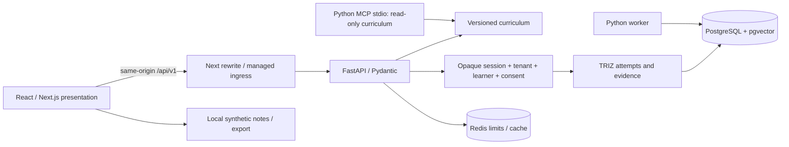

# Architecture — v0.6.0

The user's Q4 2026 correction is accepted: **Python is the principal application, backend, API and AI language.** FastAPI replaces active Next.js route-handler domain services and Prisma. The modular monolith is one Python codebase with explicit curriculum, identity/policy, learning/evidence, AI, task and infrastructure boundaries. Next.js is the browser presentation layer; its only API plumbing is forwarding requests to FastAPI.

## Ownership and trust

Python validates inputs and decides permissions. Client-supplied roles or tenant IDs convey no authority. Synthetic sessions use opaque bearer tokens stored only as hashes. Scoped learner grants, active purpose consent and tenant equality are checked for protected operations. PostgreSQL forced row policies add a second tenant boundary; deployment must use a non-owner, non-superuser, non-bypass runtime role. Migration/admin credentials never belong in the web container.

Real enrollment and generative tutoring return unavailable. Production cannot use the synthetic session path. Development tokens and seed consent are fixtures, never guardian verification. The frontend's guardian view and age selector are previews, not authorization.

Public mission content has immutable version IDs. An attempt pins one version and age band. Evidence belongs to its attempt and learner. Completion requires evidence for all seven TRIZ steps. Browser notes remain a local demonstration: selecting a learner stage does not create an API principal, and a failed curriculum request produces a visible fallback status.

## Contract and data boundaries

Pydantic is the API contract source. Exported OpenAPI drives generated TypeScript types and an `openapi-fetch` client. CI regenerates and compares output to detect drift. Browser validation supports interaction quality; the API independently validates all writes. Alembic is the only active migration history. Old Node services, tests and SQL/Prisma history are archived under `reference/legacy-typescript-backend/` and excluded from active builds. The earlier unmounted single-page learner model is preserved separately in `reference/frontend-v0.5/`; the current `/demo` is the only active learner interface.

Redis provides shared rate limiting with bounded keys and TTL, and fails closed for protected requests when unavailable. Public reviewed curriculum is cacheable; private evidence is not. Async workers are Python processes and must retain the same policy checks as request handlers. Do not place evidence bodies in queue payloads or retry rejected consent.

## AI and MCP

Reviewed curriculum ingestion, bounded chunks, source hashes/citations, a prompt registry, deterministic evaluation fixtures and provider interfaces establish the foundation. The current retrieval path is deterministic and local; a vector column does not mean production embeddings or a validated RAG service are live. No external model receives learner information. MCP exposes reviewed curriculum through stdio without learner-record tools. See [AI_SAFETY.md](AI_SAFETY.md) for the implemented and deferred controls.

## Frontend decision

Keep the existing polished Next/React interface for accessible responsive browser interaction and future SVG/WebXR work. Python remains principal product logic. Pyodide can later execute isolated lesson code in a worker, with time/memory and network limits; browser Python never establishes permission. Reflex, NiceGUI and Flet require the concrete accessibility, interaction, payload and mobile benchmarks in [the ADR](adr/0001-python-first.md) before replacing the learner UI. No benchmark results are asserted.

## Operations

Use structured metadata logs without submitted text, tokens, URLs/query strings or database secrets. OpenTelemetry exports only approved coarse spans when configured. The local Compose stack has health-gated migrations and separate migration/runtime database users. Production requires managed TLS ingress, verified database TLS, private PostgreSQL/Redis networking, separate environments/secrets, monitored backups and a demonstrated restore before any account pilot. [DEPLOYMENT.md](DEPLOYMENT.md) maps educationos.space to this stack.
