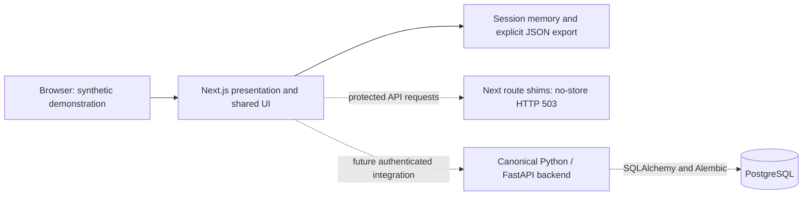

# Architecture — v0.5.0 presentation handoff

## Canonical architecture

**Python/FastAPI owns the backend, API, domain rules, authentication, and authorization. SQLAlchemy and Alembic own PostgreSQL persistence and migrations. Next.js, React, and TypeScript own presentation.** The Python backend is a separate coordinated workstream and is not implemented or validated by this frontend handoff.

This supersedes the earlier TypeScript backend direction in the recovered documentation. To preserve reviewable work without creating two active backends, the TypeScript implementation, SQL migration, and policy tests are retained under [superseded reference](../reference/typescript-backend/README.md). Do not deploy that reference as the canonical API or run its migration against a canonical Python database.

## Runtime boundaries

The solid lines describe this delivered demo. The Python/database integration remains separate work. No browser header, role selector, cookie, or environment toggle enables protected intake through these shims.

The demonstration's learner state, age selector, guardian navigation, and local export do not establish authenticated identity, adult authority, consent, or durable storage. Real enrollment remains disabled. The UI sends no learner notes to an API and stores no notes in localStorage or sessionStorage.

## Presentation modules

| Area | Responsibility |
|---|---|
| `src/app` | Page shell, metadata, styles, and unavailable API shims |
| `src/components` | Accessible shared UI and synthetic learning interaction |
| `src/lib/learning.ts` | In-memory demo progression, validation, and export |
| `src/contracts` | Provisional presentation/reference schemas pending canonical OpenAPI alignment |
| `reference/typescript-backend` | Superseded implementation and regression fixtures, excluded from the active app |
| `tests` | Presentation behavior and browser verification; reference tests are explicitly labeled |

Client-side validation improves the demo experience; it cannot replace canonical server validation or permissions. Future TypeScript API clients should derive from reviewed FastAPI OpenAPI contracts rather than duplicate domain rules independently.

## Learner experience

Five age bands adapt world context and scaffolding. The seven-step mission follows notice, contradiction, divergent alternatives, prediction, fair comparison, reflection, and transfer. Every band requests three ideas; younger learners receive adult-assisted language and drawing guidance.

Progress counts completed demonstration steps. Skills Vault entries represent practice, never inferred intelligence or mastery. Portfolio display and export include evidence only from completed steps; revising earlier work reopens that step and later steps. Refresh or reset clears the in-memory session. The exported schema is a demo format, not an authenticated canonical evidence record or guaranteed v0.4-compatible import format.

## Design system

Learner surfaces use white, near-black, lime, and generous touch targets. Adult surfaces use a restrained editorial hierarchy. Shared components use native semantic controls, connected labels, visible focus, accessible names, SVG/Lucide icons, reduced-motion support, and forced-color accommodations. Automated axe and keyboard smoke checks complement manual assistive-technology review; they do not establish full accessibility conformance or child usability.

## Canonical backend integration gates

The FastAPI implementation must establish trusted server identity, scoped adult/child permissions, tenant boundaries, verified authority/consent, immutable mission/rubric versions, version-pinned attempts, and evidence provenance. PostgreSQL access must enforce matching boundaries through reviewed SQLAlchemy repositories, database roles, and Alembic migrations. The superseded TypeScript tests are requirements examples to port and strengthen, not evidence that these Python controls passed.

Before real records: verify consent/revocation, retention/deletion/export, audit minimization, abuse limits, backup restoration, incident support, secrets and encryption, and independent security review. Curriculum, experiment safety, legal market approval, safeguarding, and accessibility remain separate release gates. See [SECURITY.md](SECURITY.md), [DATABASE.md](DATABASE.md), [API.md](API.md), and [MILESTONES.md](MILESTONES.md).
